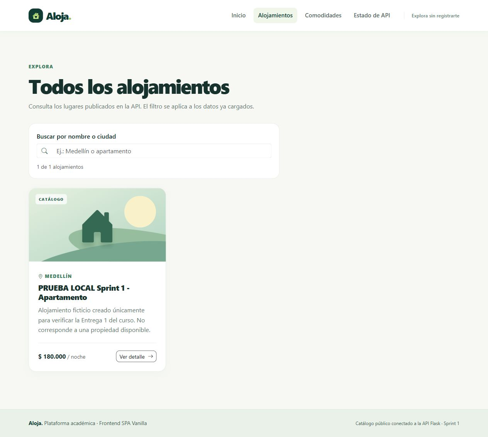
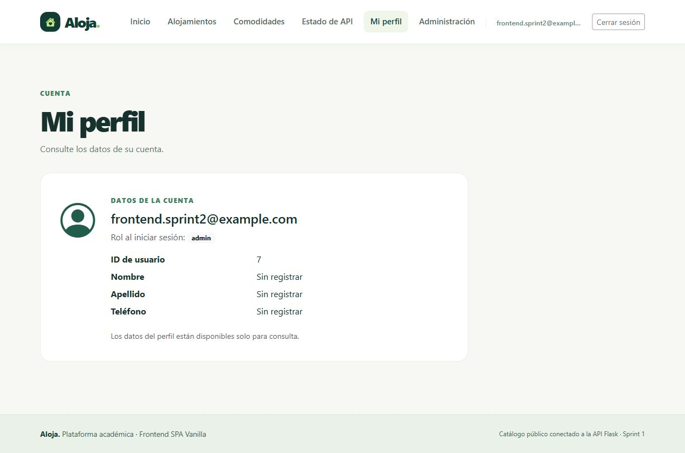
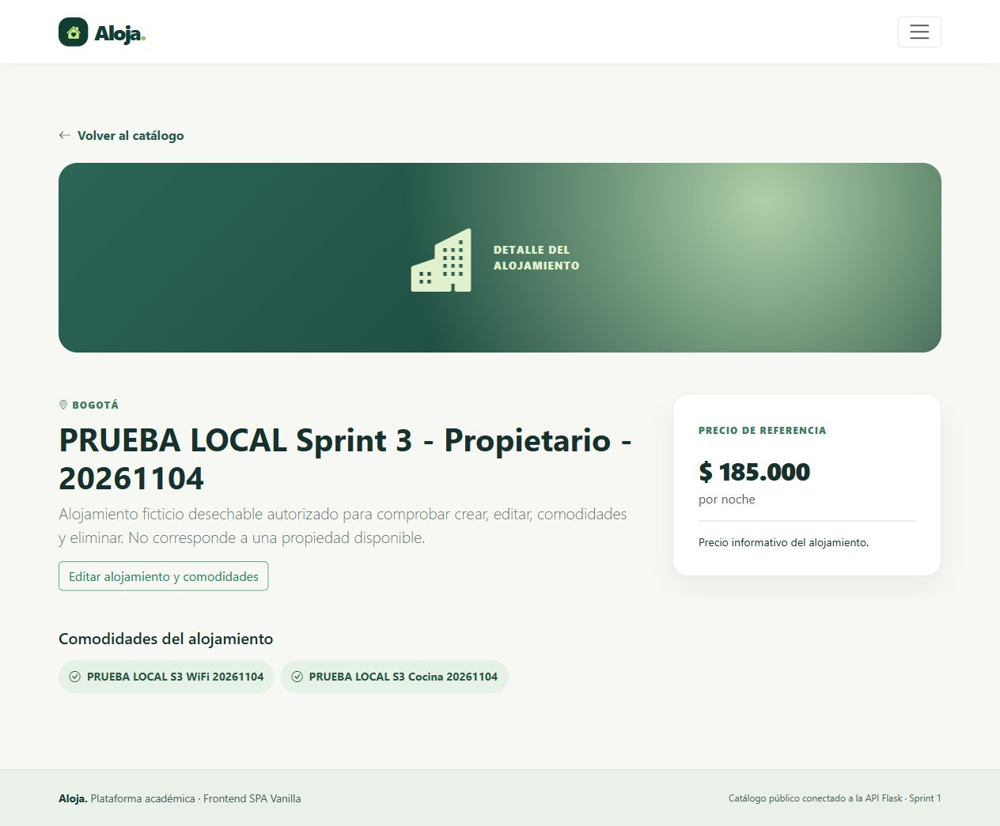

# Aloja: frontend de Alojamientos

SPA de catálogo público, autenticación y gestión de alojamientos construida con HTML5, CSS3, JavaScript ES Modules, Bootstrap 5 y Vite. Consume la API Flask del repositorio independiente `api-alojamientos`, correspondiente al Sprint 3 del backend.

El objetivo es consultar alojamientos y sus comodidades, registrar e identificar usuarios y permitir que propietarios y administradores gestionen los registros según sus permisos. El Trabajo 4 consolida los tres tutoriales; no añade funcionalidades.

## Preparación

Necesita Node compatible con Vite 8 (Node 22.12+; desarrollo comprobado con Node 24.21.0 y npm 11.19.0). Para mostrar datos reales, el backend debe estar iniciado en `http://localhost:5000`, con MySQL disponible y migración `003` aplicada. El frontend no inicia ni modifica esos servicios. `/health` comprueba Flask; por sí solo no demuestra conexión con MySQL.

Desde la raíz del frontend, en PowerShell:

```powershell
git clone https://github.com/ImpVitaLuisZ/Front-end-alojamientos.git
cd Front-end-alojamientos
npm install
Copy-Item .env.example .env
npm run dev
```

Copie la plantilla solo si todavía no tiene `.env`. En Bash, el comando equivalente es `cp .env.example .env`. Abra **http://localhost:5173**, usando `localhost` para coincidir con el origen CORS del backend.

La única variable del frontend es pública:

```env
VITE_API_URL=http://localhost:5000
```

No agregue `/api/v1` a esta URL: `/health` vive en la raíz. Reinicie Vite cuando cambie `.env`. No copie credenciales ni el `.env` del backend al frontend.

## Comandos

| Comando | Función |
| --- | --- |
| `npm install` | Instalar dependencias según package.json y package-lock.json; comando solicitado en la rúbrica |
| `npm ci` | Reinstalación estricta con las versiones fijadas en package-lock.json |
| `npm run dev` | Servir la SPA en `localhost:5173`, con puerto estricto |
| `npm test` | Ejecutar 37 pruebas: 9 de Sprint 1, 14 de Sprint 2 y 14 de Sprint 3 |
| `npm run build` | Generar la distribución en `dist/` |
| `npm run preview` | Revisar localmente la distribución generada |

Las únicas dependencias directas son `bootstrap` (`5.3`), `bootstrap-icons` (`^1.13.1`) y, para desarrollo, `vite` (`^8.0.14`). `npm install` genera o actualiza el lockfile; para reproducir la instalación, use `npm ci`.

Preview usa 4173 por defecto. Para verificar también la API con el backend del curso, cierre dev y use `npm run preview -- --host localhost --port 3000 --strictPort`: el backend utilizado autoriza localhost:3000 y localhost:5173. Confirme los orígenes permitidos en su propia configuración; no desactive CORS. `npm run dev -- --port 3000` sirve para una revisión aislada cuando 5173 está ocupado. Ni el build ni los tests requieren Flask encendido; los tests de API simulan `fetch` y no sustituyen las pruebas reales de navegador.

## Rutas y contrato HTTP

| Vista SPA | GET público de Flask |
| --- | --- |
| `/` y `/estado` | `/health` |
| `/alojamientos` | `/api/v1/alojamientos` |
| `/alojamientos/:id` | `/api/v1/alojamientos/:id` |
| `/comodidades` | `/api/v1/comodidades` |

Una ruta desconocida, como `/reservas`, muestra el 404 del frontend. Un ID inexistente muestra el 404 de alojamiento cuando Flask responde con ese estado.

`/health` entrega `{ status, service, version }`; los otros GET entregan `{ success, data }`. El cliente conserva el objeto completo. Cada alojamiento utiliza `id`, `titulo`, `descripcion`, `precio_noche`, `ciudad` y sus `comodidades` asociadas. Una comodidad contiene `id` y `nombre`.

Los datos se obtienen de Flask: no hay registros simulados en la aplicación. `data: []` muestra un estado vacío; una conexión fallida muestra un error. El filtro busca por título o ciudad en la lista ya descargada, sin nuevas peticiones por cada tecla. Para verificar tarjetas y detalles se necesita un ID existente; cualquier creación de datos requiere una autorización separada en el backend.

## Alcance y seguridad

Incluye cinco vistas públicas, 404, navegación con History API, Atrás/Adelante, filtro local, estados de carga/vacío/error y cancelación de solicitudes al cambiar de vista. Los textos de la API se escapan antes de insertarse como HTML y los IDs de tarjetas se validan. Las ilustraciones CSS son decorativas; no representan fotografías de los alojamientos.

Sprint 2 agrega registro, login, JWT en sessionStorage, perfil y listado administrativo de solo lectura. Sprint 3 incorpora CRUD de alojamientos y comodidades. No incluye reservas, pagos ni subida de fotos. El navegador no accede a MySQL; Flask valida el JWT y el rol vigente.

`VITE_*` es visible en el navegador: nunca debe contener secretos. Git excluye `.env`, `node_modules/`, `dist/`, los documentos internos y las evidencias locales. `package-lock.json` sí forma parte del código entregable.

## Estructura

- `index.html`: único documento de la SPA.
- `src/js/main.js`: Bootstrap, estilos e inicio del router.
- `src/js/config.js`: origen público de Flask.
- `src/js/api/`: cliente HTTP, consultas públicas y contratos de autenticación.
- `src/js/state/sesion.js`: sesión por pestaña y notificación de cambios.
- `src/js/components/`: navegación, pie, tarjetas y estados.
- `src/js/pages/`: vistas públicas, registro, login, perfil y administración.
- `src/js/router/`: resolución de rutas, History API y cancelación.
- `src/js/utils/`: escape HTML, moneda COP y resúmenes.
- `src/css/main.css`: diseño y adaptación móvil.
- `tests/`: once archivos; 37 pruebas de vistas públicas, autenticación, servicios CRUD, formularios y permisos.

## Diagnóstico y revisión manual

- **No conecta con Flask:** comprobar que `http://localhost:5000/health` responda y que `VITE_API_URL` indique el origen correcto. Un error de conexión no demuestra que la base esté vacía.
- **CORS:** comprobar en el navegador que Flask autorice `http://localhost:5173`; no desactivar la seguridad del navegador. Esta SPA no cambia la configuración del backend.
- **Puerto ocupado:** `strictPort` evita saltar a otro puerto. Identificar el proceso existente antes de detenerlo.
- **Lista vacía:** es válida si Flask devuelve `data: []`; no agregar datos ficticios al código.
- **Detalle y filtro:** usar un ID real obtenido del listado; comprobar título, ciudad, precio y comodidades, búsqueda sin coincidencias y un ID inexistente.
- **Navegación y accesibilidad:** revisar enlaces, Atrás/Adelante, URL directa, teclado, menú móvil y `/reservas`.
- **Errores:** revisar Console y Network; al iniciar Flask, volver a consultar la vista. No confundir el fallo de red con un HTTP 404.

Vite resuelve las rutas directas en desarrollo. Un futuro hosting necesitará reescribir las rutas de la SPA hacia `index.html`. Este sprint se prepara localmente para revisión, sin despliegue.

## Entrega 1

La [lista de entrega y el inventario de evidencias](docs/sprint-01.md) distinguen las pruebas aprobadas, la integración real y lo pendiente antes de publicar. El flujo con un alojamiento de práctica obtenido de Flask ya está verificado. La entrega se revisa mediante un PR hacia main en [Front-end-alojamientos](https://github.com/ImpVitaLuisZ/Front-end-alojamientos); el backend sigue separado.

## Autenticación y sesión (Sprint 2)

| Vista SPA | Petición de Flask | Acceso |
| --- | --- | --- |
| `/registro` | POST `/api/v1/usuarios/registro` | Público |
| `/login` | POST `/api/v1/usuarios/login` | Público |
| `/perfil` | GET `/api/v1/usuarios/perfil` | Bearer JWT |
| `/admin/usuarios` | GET `/api/v1/admin/usuarios` | Bearer JWT y rol admin |

Registro y login envían únicamente `correo` y `contrasena`. La confirmación de contraseña se valida en la interfaz. Registro devuelve el usuario, no un token: después se inicia sesión. El login devuelve `data.access_token` y `data.usuario`; la pestaña guarda únicamente el token y los datos públicos `id`, `correo`, `rol`. No se guardan contraseñas.

Sin sesión, las rutas privadas llevan a login. La Navbar cambia con la sesión y el rol del último login. Un usuario normal ve acceso restringido al abrir la dirección administrativa; Flask comprueba de forma independiente cada permiso. El perfil puede mostrar «Sin registrar» en sus campos opcionales.

Un 401 de la petición protegida correspondiente a la sesión actual la elimina; un 401 del login público o un 403 conserva la sesión existente. Logout limpia la sesión local: no revoca el JWT en el servidor. No existen endpoints de logout, refresh, edición de perfil ni cambio de roles en esta interfaz. Los errores 400/409 se muestran en los formularios. `next` solo permite destinos privados conocidos.

Las 23 pruebas y el build pasaron nuevamente el 4 de noviembre de 2026. Se verificaron registro, login, perfil y permisos mediante HTTP real. En el navegador real se comprobaron login, perfil, recarga, Admin, logout y errores 401/409. La [verificación de Sprint 2](docs/sprint-02.md) distingue cada alcance y contiene las evidencias. [Issue #3](https://github.com/ImpVitaLuisZ/Front-end-alojamientos/issues/3), rama `feat/frontend-sprint-02-autenticacion`; integrado mediante [PR #4](https://github.com/ImpVitaLuisZ/Front-end-alojamientos/pull/4).

## Gestión de alojamientos y comodidades (Sprint 3)

| Vista SPA | Operación de Flask | Permiso |
| --- | --- | --- |
| `/mis-alojamientos` | GET público `/api/v1/alojamientos`, filtrado local por usuario_id | Sesión para la vista |
| `/alojamientos/nuevo` | POST `/api/v1/alojamientos` | JWT |
| `/alojamientos/:id/editar` | GET detalle, PATCH y DELETE `/api/v1/alojamientos/:id` | Propietario o Admin para modificar |
| Edición: Guardar comodidades | PATCH `/api/v1/alojamientos/:id/comodidades` | Propietario o Admin |
| `/admin/comodidades/nueva` | POST `/api/v1/comodidades` | Admin |

El formulario envía solo titulo, descripcion, ciudad y precio_noche. Flask asigna usuario_id desde el JWT. El precio debe ser positivo, con punto decimal y hasta dos decimales. El formulario compartido se precarga al editar; guardar campos y guardar comodidades son acciones independientes.

La lista comodidades_ids reemplaza todas las asociaciones; `[]` las retira. No elimina comodidades del catálogo. La eliminación de un alojamiento exige confirmación y procesa 204 sin intentar leer JSON. Un 403 conserva la sesión, un 401 protegido la limpia y los mensajes 400/404/409 permiten corregir la operación.

Mis alojamientos filtra un catálogo público: ese filtro y ocultar enlaces no conceden ni protegen permisos. Flask autoriza cada cambio. Se necesitan cuentas locales de prueba normal y Admin para verificar los dos roles; la promoción pertenece al backend. Nunca publique contraseñas ni copie su configuración de MySQL al frontend.

La implementación sigue el tutorial estudiantil TUTORIAL-03.md: servicios API, utils/gestion.js, AlojamientoForm y ComodidadesSelector, cuatro páginas nuevas y ampliación de rutas/Navbar/detalle. Se conservan http.js, router.js, sesion.js, servicios anteriores, dependencias y las 23 pruebas previas.

37/37 pruebas, sintaxis y build aprobados el 4 de noviembre. Verificados realmente: creación/edición, Admin, permisos 403, comodidades 201/409, asociaciones con dos elementos y [], y DELETE 204 seguido de GET 404. Las vistas móviles se revisaron a 390 px. Queda pendiente comprobar manualmente Confirmar/Cancelar: la herramienta del navegador se bloqueó en window.confirm y los borrados se verificaron mediante los servicios JS reales. El PR #6 está integrado en main; consulte [Sprint 3](docs/sprint-03.md) y [Issue #5](https://github.com/ImpVitaLuisZ/Front-end-alojamientos/issues/5). Las pruebas con fetch simulado no demuestran cambios en MySQL.

## Entrega final y evidencias

| Etapa | Documentación | Seguimiento |
| --- | --- | --- |
| SPA pública | [Sprint 1](docs/sprint-01.md) | [Issue 1](https://github.com/ImpVitaLuisZ/Front-end-alojamientos/issues/1), [PR 2 integrado](https://github.com/ImpVitaLuisZ/Front-end-alojamientos/pull/2) |
| Autenticación y roles | [Sprint 2](docs/sprint-02.md) | [Issue 3](https://github.com/ImpVitaLuisZ/Front-end-alojamientos/issues/3), [PR 4 integrado](https://github.com/ImpVitaLuisZ/Front-end-alojamientos/pull/4) |
| CRUD y comodidades | [Sprint 3](docs/sprint-03.md) | [Issue 5](https://github.com/ImpVitaLuisZ/Front-end-alojamientos/issues/5), [PR 6 integrado](https://github.com/ImpVitaLuisZ/Front-end-alojamientos/pull/6) |
| Consolidación | [Trabajo 4](docs/entrega-final.md) | [Issue 7](https://github.com/ImpVitaLuisZ/Front-end-alojamientos/issues/7) |

Capturas de los recorridos reales:





Cada guía enlaza sus resultados HTTP, capturas adicionales y límites. Los registros son ficticios de la base local del curso; el ZIP no contiene una base de datos ni contraseñas. Las capturas históricas del alojamiento 3 preceden su eliminación autorizada. Los ejemplos sintéticos están identificados y no sustituyen la integración real.

La revisión visual de Confirmar/Cancelar sigue pendiente por una limitación de la herramienta del navegador. El código conserva window.confirm; DELETE real 204 y GET posterior 404 sí se verificaron. Consulte el procedimiento manual en Sprint 3 antes de dar por concluida la aceptación completa.
